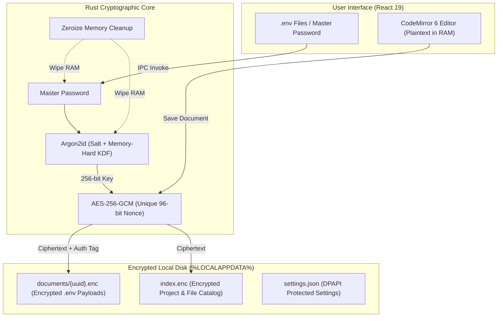

<div align="center">

# 🛡️ Env Vault — Güvenli .env & Secret Yönetim Uygulaması

</div>

---

<div align="center">

[](#english-version)
&nbsp;&nbsp;&nbsp;&nbsp;
[](#turkish-version)

</div>

---

<div align="center">


</div>

---

<a id="english-version"></a>
# English Version

<div align="center">
  
  <h3>Env Vault — Military-Grade Encrypted .env & Secret Manager</h3>
  <p><em>Independent, Local-First, Zero-Knowledge Environment Variable Vault for Windows Developers</em></p>
  <p><strong>Developed & Published by <a href="https://vellium.dev">Vellium</a></strong></p>
</div>

<br>

## 💻 Project Overview

**Env Vault** is an enterprise-grade, local-first Windows desktop application built with **Tauri 2.0 (Rust)** and **React 19 (TypeScript)**. It empowers software developers and DevOps engineers to manage, edit, organize, and back up all their sensitive `.env` files and environment variables in an isolated, encrypted vault—completely independent of local project working trees.

Traditional workflows store `.env` files directly inside project folders where they risk accidental Git commits, deletion during branch cleanup, or loss during directory resets. **Env Vault** solves this with a **Copy-In Storage Architecture**: imported `.env` files are encrypted and permanently decoupled from the source filesystem. Even if the original repository or source file is deleted, your secrets remain intact, secured behind **Argon2id** key derivation and **AES-256-GCM** authenticated encryption.

Env Vault operates **100% offline** with zero telemetry, zero analytics, and zero external server dependencies.

---

## 🚀 Key Features

- **Copy-In Storage Architecture**: Imports `.env` files into an isolated encrypted local vault (`%LOCALAPPDATA%/com.vellium.envvault/vault/`). The vault copy is completely independent from the original source file.
- **Military-Grade Cryptography**:
  - **Argon2id KDF**: Industry-standard memory-hard password hashing with salt and dynamic iteration parameters.
  - **AES-256-GCM**: Authenticated symmetric encryption with unique per-document 96-bit initialization vectors (IV/Nonce).
  - **Windows DPAPI Integration**: Secure hardware-bound credential protection for system settings and session tokens.
  - **Zeroize Memory Protection**: Critical secrets, master passwords, and plaintext buffers are wiped from RAM immediately after use.
- **Syntax-Highlighted CodeMirror 6 Editor**: Built-in environment file editor with syntax coloring for keys, values, comments, multi-line strings, variable expansion, and one-click secret value masking/unmasking.
- **Drag-and-Drop Batch Importer**: Drag one or multiple `.env` files (`.env`, `.env.production`, `.env.local`, etc.) or entire project folders directly into the window for instant parsing and encryption.
- **Single-Click & Batch Exporter**: Export individual `.env` files back to their original paths, prompt for new locations, or batch export entire project vaults simultaneously.
- **Encrypted Vault Backup & Restore**: Export full vault archives as encrypted `.evault` backup files with cryptographic integrity hashing and one-click restore.
- **Dynamic 16-Theme Engine**: Hand-curated color schemes including Dark Velvet, OLED Pitch Black, Midnight Cyber, Glassmorphism, Clean Light, and Cyberpunk Neon.
- **100% Multi-Language (i18n)**: Fully localized Turkish (`tr`) and English (`en`) interfaces with instant header bar language switching.
- **System Tray & Single-Instance Daemon**: Minimize to system tray on close or hide, single-instance mutex prevention to avoid duplicate processes, and customizable auto-lock timer.
- **Offline & Zero-Knowledge**: No analytics, no telemetry, no tracking, and zero internet requests required.

---

## 🛠️ Tech Stack

<div align="center">


</div>

### Backend & Cryptography (Rust)
- **Tauri 2.2**: Native Windows runtime integration, window styling, and secure IPC bridge
- **Argon2 0.5**: Argon2id memory-hard key derivation function
- **AES-GCM 0.10**: AES-256-GCM authenticated cipher engine
- **Zeroize 1.8**: RAM memory zeroing on drop for sensitive structs
- **Windows API (`windows-rs` 0.58)**: Win32 DPAPI, Shell, System, and Cryptography integration
- **Single Instance Plugin**: `tauri-plugin-single-instance` for single-process mutex enforcement

### Frontend & UI (React & TypeScript)
- **React 19 & TypeScript 5.7**: Component-driven reactive user interface
- **CodeMirror 6**: Modular environment syntax highlighter and code editor
- **Zustand 5**: Ultra-lightweight state stores (`usePreferencesStore`, `useEditorStore`, `useProjectsStore`)
- **Lucide React**: Clean, modern SVG icon set
- **Custom CSS Design Tokens**: Zero-framework vanilla CSS with CSS variables, HSL color system, glassmorphism, and responsive layouts

---

## 📁 Project Structure

```tree
Env_Vault/
├── .github/                        # GitHub Actions & CI/CD workflows
├── docs/                           # Architecture documentation & release specs
│   ├── release/                    # Build prechecks, store metadata, release notes
│   └── env-vault-urun-gelistirme.md# Master product development document
├── public/                         # Public static assets & vector brand logo
│   └── logo.svg
├── release/                        # Production builds & distribution artifacts
│   ├── Env-Vault-1.0.0-Windows-x64-Setup.exe   # NSIS Setup Installer
│   ├── Env-Vault-1.0.0-Windows-x64.msi         # MSI Enterprise Installer
│   ├── Env-Vault-1.0.0-Windows-x64-Portable.exe# Standalone Portable Binary
│   ├── Env-Vault-1.0.0-Windows-x64-Portable.zip# Portable Archive + License
│   ├── SHA256SUMS.txt                          # Cryptographic checksums
│   ├── Dogrula-SHA256.bat                      # 1-Click checksum verifier
│   └── README-KURULUM.txt                      # Turkish installation manual
├── scripts/                        # Automated build & verification tools
│   ├── build-release.ps1           # Release builder (Tests -> Build -> Package)
│   ├── check-version-consistency.js# Version synchronization validator
│   └── generate-icons.py           # Multi-resolution ICO/PNG generator
├── src/                            # Frontend application source (React 19 + TS)
│   ├── app/                        # Root application component & layout
│   ├── components/                 # Shared UI library (Button, Dialog, Toast, TitleBar)
│   ├── features/                   # Domain features
│   │   ├── backup/                 # Encrypted backup & restore modals
│   │   ├── env-documents/          # Document cards, list, and actions
│   │   ├── env-editor/             # CodeMirror 6 editor & secret masks
│   │   ├── import/                 # Drag-and-drop batch import dialogs
│   │   ├── projects/               # Project sidebar, tree, and selectors
│   │   ├── settings/               # Master settings, auto-lock, tray config
│   │   └── vault/                  # Master password setup & lock screen
│   ├── i18n/                       # Localization engine (English & Turkish)
│   │   ├── locales/                # Dictionary files (en.ts, tr.ts)
│   │   └── index.ts                # Reactive useTranslation hook
│   ├── lib/                        # Tauri IPC API bindings & utilities
│   ├── stores/                     # Zustand state management stores
│   ├── styles/                     # CSS design tokens, themes & animations
│   └── types/                      # Global TypeScript definitions
├── src-tauri/                      # Rust backend & cryptographic core
│   ├── icons/                      # App icons (ICO, ICNS, PNG, NSIS BMPs)
│   ├── src/
│   │   ├── backup/                 # Encrypted archive serializer & deserializer
│   │   ├── crypto/                 # Argon2id, AES-256-GCM & Zeroize wrappers
│   │   ├── env/                    # .env parser, serializer & key extractor
│   │   ├── export/                 # File & batch disk export service
│   │   ├── import/                 # Copy-in file import & directory scanner
│   │   ├── platform/               # Windows DPAPI & shell bindings
│   │   ├── settings/               # Encrypted settings store & models
│   │   ├── vault/                  # Vault service, master lock & session manager
│   │   ├── lib.rs                  # Tauri command handlers & plugin bootstrap
│   │   └── main.rs                 # Native binary entry point
│   ├── Cargo.toml                  # Rust dependencies & package config
│   └── tauri.conf.json             # Tauri window, security & bundle metadata
├── package.json                    # Node dependencies & npm scripts
├── tsconfig.json                   # TypeScript compiler configuration
├── vite.config.ts                  # Vite build & bundler configuration
└── README.md                       # Master Documentation
```

---

## 🔐 Storage & Cryptographic Architecture



### Data Storage Specifications

| Storage File | Encryption Standard | Description |
| :--- | :--- | :--- |
| `vault/index.enc` | **AES-256-GCM** | Master catalog of all projects, `.env` file metadata, and relations |
| `vault/documents/*.enc` | **AES-256-GCM** | Payload ciphertext with unique salt, nonce, and authentication tag |
| `vault/vault.json` | **Argon2id + Salt** | Vault metadata header, KDF configuration parameters, and verification tag |
| `settings.json` | **Windows DPAPI** | Application preferences, theme selection, language choice, and auto-lock interval |

---

## ⚙️ Installation & Usage

### Prerequisites
- **Node.js**: Version 18.0.0 or higher
- **Rust & Cargo**: Version 1.75.0 or higher
- **Windows**: Windows 10 (1809+) or Windows 11 (64-bit x64)
- **WebView2**: Included by default in Windows 10/11

### Step-by-Step Developer Setup

1. **Clone the Repository:**
   ```bash
   git clone https://github.com/emirtdede/Env_Vault.git
   cd Env_Vault
   ```

2. **Install Node Dependencies:**
   ```bash
   npm install
   ```

3. **Run Automated Test Suites:**
   ```bash
   # Run Frontend Unit & i18n Tests (Vitest)
   npm test

   # Run Rust Cryptography & Backend Tests (Cargo)
   cd src-tauri
   cargo test
   cd ..
   ```

4. **Start Local Development Mode:**
   ```bash
   npm run tauri dev
   ```

5. **Build Production Release Artifacts:**
   ```bash
   # Automated release pipeline (Tests -> NSIS -> MSI -> Portable -> SHA256)
   powershell.exe -NoProfile -ExecutionPolicy Bypass -File scripts/build-release.ps1
   ```

---

## 📦 Pre-Compiled Distribution Packages

Ready-to-use production packages are generated inside the [`release/`](file:///c:/Users/emir/Desktop/Env_Vault/release) directory:

- **NSIS Setup Installer**: `Env-Vault-1.0.0-Windows-x64-Setup.exe` *(Full installer with start menu shortcuts)*
- **MSI Enterprise Installer**: `Env-Vault-1.0.0-Windows-x64.msi` *(Enterprise & GPO silent deployment)*
- **Standalone Portable**: `Env-Vault-1.0.0-Windows-x64-Portable.exe` *(Zero installation, run from USB or any folder)*
- **Portable Zip**: `Env-Vault-1.0.0-Windows-x64-Portable.zip` *(Compressed archive with License)*
- **Integrity Verification**: `Dogrula-SHA256.bat` & `SHA256SUMS.txt`

---

## ⚖️ License

Distributed under the **MIT License**. See [`LICENSE`](file:///c:/Users/emir/Desktop/Env_Vault/LICENSE) for more information.

**Official Website**: [Vellium.dev](https://vellium.dev) &bull; **Publisher**: Vellium

---

<br>

---

<a id="turkish-version"></a>
# Türkçe Versiyon

<div align="center">
  
  <h3>Env Vault — Askeri Düzeyde Şifreli .env ve Gizli Değişken Yöneticisi</h3>
  <p><em>Yazılım Geliştiriciler İçin Proje Klasörlerinden Bağımsız, %100 Yerel ve Şifreli Windows Masaüstü Kasası</em></p>
  <p><strong>Geliştirici ve Yayıncı: <a href="https://vellium.dev">Vellium</a></strong></p>
</div>

<br>

## 💻 Project Overview (Proje Genel Bakışı)

**Env Vault**, **Tauri 2.0 (Rust)** ve **React 19 (TypeScript)** teknolojileriyle geliştirilmiş, kurumsal düzeyde bir Windows masaüstü uygulamasıdır. Yazılım geliştiricilerin, sistem yöneticilerinin ve DevOps uzmanlarının hassas `.env` ortam dosyalarını ve API secret anahtarlarını yerel proje klasörlerinden tamamen bağımsız, şifreli bir kasada güvenle saklamalarını, yönetmelerini ve düzenlemelerini sağlar.

Geleneksel geliştirme süreçlerinde `.env` dosyaları doğrudan proje dizininde tutulduğu için yanlışlıkla Git deposuna commit edilme, dal (branch) temizliğinde silinme veya proje dizini silindiğinde kaybolma riski taşır. **Env Vault**, bu problemi **Copy-In (Bağımsız Kopyalama) Mimarisi** ile çözer: Kasaya aktarılan her `.env` dosyası şifrelenerek kaynak dizinden tamamen bağımsız hale getirilir. Kaynak proje veya orijinal dosya silinse dahi verileriniz **Argon2id** anahtar türetme ve **AES-256-GCM** şifreleme güvencesiyle kasada korunur.

Uygulama **%100 çevrimdışı (offline-first)** çalışır; hiçbir sunucuya bağlanmaz, telemetri veya analitik verisi toplamaz.

---

## 🚀 Key Features (Önemli Özellikler)

- **Bağımsız Kasa Mimarisi (Copy-in Architecture)**: `.env` dosyaları kasaya aktarıldığı anda `%LOCALAPPDATA%/com.vellium.envvault/vault/` dizininde şifreli olarak saklanır ve orijinal kaynak dosyadan tamamen bağımsız hale gelir.
- **Askeri Düzeyde Kriptografik Güvenlik**:
  - **Argon2id KDF**: Bellek-yoğun modern parola türetme fonksiyonu ile brute-force saldırılarına karşı tam koruma.
  - **AES-256-GCM**: Her bir dosya için benzersiz 96-bit IV (Nonce) ve kimlik doğrulama etiketi (Auth Tag) ile simetrik şifreleme.
  - **Windows DPAPI Koruması**: Sistem ayarları ve donanım kilitli güvenlik için Windows Data Protection API entegrasyonu.
  - **Zeroize Bellek Temizliği**: Parolalar, türetilmiş anahtarlar ve ham veriler işlem bittiğinde RAM'den güvenli şekilde sıfırlanarak temizlenir.
- **Sözdizimi Vurgulamalı CodeMirror 6 Editörü**: Anahtarlar, değerler, yorum satırları, çok satırlı dizgiler ve değişken tanımları için özel renklendirme; tek tıkla gizli değerleri gizleme/gösterme (masking) desteği.
- **Sürükle-Bırak Toplu İçe Aktarma**: Masaüstünden veya Dosya Gezgini'nden birden fazla `.env` dosyasını (`.env`, `.env.production`, `.env.staging` vb.) veya proje klasörünü sürükleyip bırakarak anında şifreli kasaya ekleme.
- **Tek Tıkla ve Toplu Dışa Aktarma**: Düzenlenen ortam dosyalarını orijinal dizinlerine tek tıkla geri yazma, farklı konuma aktarma veya bir projenin tüm dosyalarını tek seferde dışa aktarma.
- **Şifreli Kasa Yedeği & Geri Yükleme**: Tüm kasa içeriğini tek bir şifreli `.evault` yedek dosyası olarak dışa aktarma ve şifre doğrulamasıyla geri yükleme.
- **Dinamik 16 Renk Teması**: Koyu Kadife, Saf OLED Siyahı, Gece Mavisi, Cam Efektli (Glassmorphism), Aydınlık ve Siberpunk gibi 16 canlı tema seçeneği.
- **%100 İki Dilli Altyapı (i18n)**: Başlık çubuğundan anında değiştirilebilen %100 Türkçe ve %100 İngilizce dil desteği.
- **Sistem Tepsisi & Tek Örnek (Single-Instance) Koruması**: Kapatıldığında sistem tepsisine küçülebilme, çoklu pencere karmaşasını önleyen tek örnek kilidi ve ayarlanabilir otomatik kilitleme süresi.
- **Tamamen Çevrimdışı ve Sıfır Telemetri**: Sıfır dış ağ isteği, sıfır analiz, sıfır takip.

---

## 🛠️ Tech Stack (Teknoloji Yığını)

<div align="center">


</div>

### Arka Uç ve Kriptografi (Rust)
- **Tauri 2.2**: Windows yerel platform entegrasyonu, pencere yönetimi ve güvenli IPC köprüsü
- **Argon2 0.5**: Argon2id bellek-yoğun anahtar türetme motoru
- **AES-GCM 0.10**: AES-256-GCM kimlik doğrulamalı simetrik şifreleme
- **Zeroize 1.8**: Bellekteki hassas verilerin struct yok edildiğinde otomatik sıfırlanması
- **Windows API (`windows-rs` 0.58)**: Win32 DPAPI, Shell, Sistem ve Kripto bağlayıcıları
- **Tekil Süreç Eklentisi**: `tauri-plugin-single-instance` ile tekil process kilidi

### Ön Yüz ve Kullanıcı Arayüzü (React & TypeScript)
- **React 19 & TypeScript 5.7**: Bileşen odaklı, modern reaktif arayüz
- **CodeMirror 6**: Modüler `.env` sözdizimi vurgulayıcı ve gelişmiş kod editörü
- **Zustand 5**: Ultra hafif reaktif durum yönetimi
- **Lucide React**: Tutarlı ve modern SVG ikon seti
- **Özel CSS Tasarım Sistemi**: CSS Değişkenleri, HSL renk paleti, cam efektleri ve akıcı mikro animasyonlar

---

## 📁 Project Structure (Proje Klasör Yapısı)

```tree
Env_Vault/
├── .github/                        # GitHub Actions & CI/CD iş akışları
├── docs/                           # Mimari dokümanlar ve sürüm spesifikasyonları
│   ├── release/                    # Ön kontroller, Store metaverileri ve sürüm notları
│   └── env-vault-urun-gelistirme.md# Ana ürün geliştirme dokümanı
├── public/                         # Statik varlıklar ve vektörel logo
│   └── logo.svg
├── release/                        # Üretim paketleri ve dağıtım dosyaları
│   ├── Env-Vault-1.0.0-Windows-x64-Setup.exe   # NSIS Kurulum Sihirbazı
│   ├── Env-Vault-1.0.0-Windows-x64.msi         # MSI Kurumsal Kurulum Paketi
│   ├── Env-Vault-1.0.0-Windows-x64-Portable.exe# Taşınabilir Tekil Exe
│   ├── Env-Vault-1.0.0-Windows-x64-Portable.zip# Taşınabilir Arşiv + Lisans
│   ├── SHA256SUMS.txt                          # Kriptografik sağlama özetleri
│   ├── Dogrula-SHA256.bat                      # Tek tıkla hash doğrulama aracı
│   └── README-KURULUM.txt                      # Türkçe kurulum kılavuzu
├── scripts/                        # Otomatik derleme ve doğrulama scriptleri
│   ├── build-release.ps1           # Release derleyici (Test -> Build -> Paketleme)
│   ├── check-version-consistency.js# Sürüm tutarlılık kontrol scripti
│   └── generate-icons.py           # Çok çözünürlüklü ikon üretici
├── src/                            # Ön yüz kaynak kodları (React 19 + TypeScript)
│   ├── app/                        # Ana uygulama kökü ve layout düzeni
│   ├── components/                 # Paylaşılan UI kütüphanesi (Buton, Modal, Toast)
│   ├── features/                   # Özellik modülleri
│   │   ├── backup/                 # Şifreli yedekleme ve geri yükleme modalleri
│   │   ├── env-documents/          # Ortam dosyası kartları, listesi ve işlemleri
│   │   ├── env-editor/             # CodeMirror 6 editörü ve secret maskeleme
│   │   ├── import/                 # Sürükle-bırak toplu içe aktarma ekranları
│   │   ├── projects/               # Proje kenar çubuğu, ağaç yapısı ve filtreler
│   │   ├── settings/               # Genel ayarlar, otomatik kilitleme, tepsi ayarı
│   │   └── vault/                  # Ana parola kurulumu ve kilit açma ekranı
│   ├── i18n/                       # Çoklu dil altyapısı (Türkçe & İngilizce)
│   │   ├── locales/                # Sözlük dosyaları (en.ts, tr.ts)
│   │   └── index.ts                # useTranslation hook'u
│   ├── lib/                        # Tauri IPC komut bağlayıcıları
│   ├── stores/                     # Zustand durum depoları
│   ├── styles/                     # Tasarım tokenları, temalar ve animasyonlar
│   └── types/                      # Global TypeScript tip tanımları
├── src-tauri/                      # Rust arka uç ve kriptografik çekirdek
│   ├── icons/                      # Uygulama ikonları (ICO, ICNS, PNG, NSIS BMP)
│   ├── src/
│   │   ├── backup/                 # Şifreli arşiv serileştirme ve açma servisi
│   │   ├── crypto/                 # Argon2id, AES-256-GCM ve Zeroize modülleri
│   │   ├── env/                    # .env ayrıştırıcı, formatlayıcı ve anahtar çıkarıcı
│   │   ├── export/                 # Diske tekil ve toplu dışa aktarma servisi
│   │   ├── import/                 # Dosya içe aktarma ve klasör tarama servisi
│   │   ├── platform/               # Windows DPAPI ve shell entegrasyonları
│   │   ├── settings/               # Şifreli ayar deposu ve modeller
│   │   ├── vault/                  # Kasa servisi, ana kilit ve oturum yönetimi
│   │   ├── lib.rs                  # Tauri komut işleyicileri ve eklenti başlatma
│   │   └── main.rs                 # Yerel yürütülebilir dosya giriş noktası
│   ├── Cargo.toml                  # Rust bağımlılıkları ve paket yapılandırması
│   └── tauri.conf.json             # Tauri pencere, güvenlik ve bundle ayarları
├── package.json                    # Node bağımlılıkları ve npm scriptleri
├── tsconfig.json                   # TypeScript derleyici yapılandırması
├── vite.config.ts                  # Vite derleyici yapılandırması
└── README.md                       # Ana Dokümantasyon
```

---

## 💾 Storage & Encryption Schema (Kasa Şeması ve Depolama Yapısı)

| Dosya Yolu | Şifreleme Standardı | Açıklama |
| :--- | :--- | :--- |
| `vault/index.enc` | **AES-256-GCM** | Proje ve dosya hiyerarşisini tutan şifreli ana katalog |
| `vault/documents/*.enc` | **AES-256-GCM** | Her bir `.env` dosyasının benzersiz salt ve nonce ile şifrelenmiş içeriği |
| `vault/vault.json` | **Argon2id + Salt** | Kasa metaverisi, KDF parametreleri ve ana parola doğrulama başlığı |
| `settings.json` | **Windows DPAPI** | Arayüz tercihleri, seçili tema, dil ve otomatik kilitleme süresi |

---

## ⚙️ Installation & Usage (Kurulum ve Kullanım)

### Gereksinimler
- **Node.js**: Sürüm 18.0.0 veya üzeri
- **Rust & Cargo**: Sürüm 1.75.0 veya üzeri
- **İşletim Sistemi**: Windows 10 (1809+) veya Windows 11 (64-bit x64)
- **WebView2 Çalışma Zamanı**: Windows 10 ve 11'de varsayılan olarak yerleşiktir

### Adım Adım Geliştirici Kurulumu

1. **Depoyu Klonlayın:**
   ```bash
   git clone https://github.com/emirtdede/Env_Vault.git
   cd Env_Vault
   ```

2. **Node Bağımlılıklarını Yükleyin:**
   ```bash
   npm install
   ```

3. **Otomatik Testleri Çalıştırın:**
   ```bash
   # Frontend Birim ve i18n Testlerini Çalıştırın (Vitest)
   npm test

   # Rust Kriptografi ve Backend Testlerini Çalıştırın (Cargo)
   cd src-tauri
   cargo test
   cd ..
   ```

4. **Geliştirici Modunda Başlatın:**
   ```bash
   npm run tauri dev
   ```

5. **Production Release Paketlerini Derleyin:**
   ```bash
   # Otomatik derleme scripti (Testler -> NSIS -> MSI -> Portable -> SHA-256)
   powershell.exe -NoProfile -ExecutionPolicy Bypass -File scripts/build-release.ps1
   ```

---

## 📦 Dağıtım Paketleri

Hazır derlenmiş resmi release paketleri [`release/`](file:///c:/Users/emir/Desktop/Env_Vault/release) klasöründe bulunmaktadır:

- **NSIS Kurulum Sihirbazı**: `Env-Vault-1.0.0-Windows-x64-Setup.exe` *(Başlat menüsü ve masaüstü kısayolları ile)*
- **MSI Kurumsal Installer**: `Env-Vault-1.0.0-Windows-x64.msi` *(Sessiz kurulum ve GPO dağıtımına uygun)*
- **Standalone Taşınabilir Sürüm**: `Env-Vault-1.0.0-Windows-x64-Portable.exe` *(Kurulumsuz, tek tıkla çalışır)*
- **Taşınabilir Zip Arşivi**: `Env-Vault-1.0.0-Windows-x64-Portable.zip` *(Lisans dosyasıyla birlikte sıkıştırılmış paket)*
- **Bütünlük Doğrulama**: `Dogrula-SHA256.bat` ve `SHA256SUMS.txt`

---

## ⚖️ License (Lisans)

Bu proje **MIT Lisansı** ile lisanslanmıştır. Detaylar için [`LICENSE`](file:///c:/Users/emir/Desktop/Env_Vault/LICENSE) dosyasına başvurabilirsiniz.

**Resmi Web Sitesi**: [Vellium.dev](https://vellium.dev) &bull; **Yayıncı**: Vellium
