<div align="center">

<a href="https://vellium.dev" target="_blank" rel="noopener noreferrer">
  
</a>

<br /><br />

# Env Vault - Encrypted, Local-First .env &amp; Secret Manager for Windows

</div>

---

<div align="center">

[](#english-version)
&nbsp;&nbsp;&nbsp;&nbsp;
[](#turkish-version)

</div>

---

<div align="center">

[](https://github.com/emirtdede/env-vault/actions/workflows/ci.yml)


</div>

---

<a id="english-version"></a>
# English Version

<div align="center">
  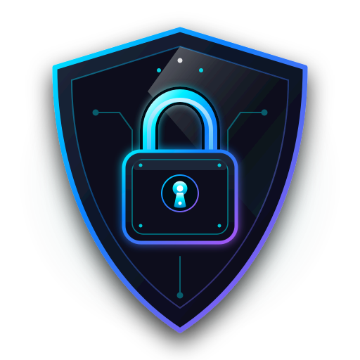
  <h3>Env Vault - Keep every secret out of every repository</h3>
  <p><em>Copy-in encrypted vault, 73-language interface, 4 system-wide icon packs, serverless cloud sync and native Windows integration</em></p>
  <p><strong>Developed &amp; Published by <a href="https://vellium.dev">Vellium</a></strong></p>
</div>

<br>

## Project Overview

**Env Vault (`v1.0.0`)** is a local-first Windows desktop application for storing, editing, organizing and exporting `.env` files outside of project folders. It is built with **Tauri 2 (Rust)** for the native core and **React 19 + TypeScript** for the interface.

Project folders are the wrong place for secrets. A `.env` file can be committed by accident, deleted during a branch cleanup, or lost when a directory is rebuilt. Env Vault imports the file into an encrypted vault and keeps a copy that is completely independent of the source. Deleting the repository, switching machines, or resetting a directory does not remove the stored copy.

Core operation is fully offline: no account, no telemetry, no external API and no server component. Cloud sync is optional and writes a single encrypted archive into a folder the user already owns (OneDrive, Google Drive, Dropbox, iCloud Drive, Yandex Disk, Nextcloud, or any folder on disk).

> **Documentation:** product report and screenshots live in [`docs/PROJECT_REPORT.md`](docs/PROJECT_REPORT.md). The pre-deployment quality audit is in [`docs/QA_AUDIT.md`](docs/QA_AUDIT.md).

---

## Key Features

### Copy-In Encrypted Vault
- Import `.env` files by drag and drop, by file picker, or by pasting raw key/value content.
- The vault copy is stored under `%LOCALAPPDATA%/EnvVault/` and is never linked to the source file again.
- Projects group related documents (`development`, `staging`, `production`), with per-document notes and timestamps.
- Export back to a `.env` file at any time, with a collision policy that can ask, overwrite, or keep both versions.

### Cryptography and Key Handling
- **Argon2id** password-based key derivation with a per-vault salt.
- **AES-256-GCM** authenticated encryption for every stored document; a tampered blob fails authentication instead of decrypting silently.
- The derived key exists only in process memory and is dropped on lock, on window close with the lock action, and on idle lock.
- The master password is never persisted, never written to logs and never included in diagnostics exports.
- Manual lock, idle auto-lock and lock-on-minimize are available from Settings and the tray menu.

### 73-Language Interface
- 73 selectable locales with English fallback for strings that are not translated yet.
- Full right-to-left mirroring for Arabic, Hebrew, Persian and Urdu.
- The Windows display language is used on first launch; English is the fallback when the locale is not in the catalog.
- Language can be changed at any time from the title bar or Settings, without restarting the app.

### Themes, Custom Accent and Accessibility
- **16 built-in themes**: 8 dark (`Obsidian`, `Graphite`, `Navy`, `Purple`, `Forest`, `Crimson`, `Amber`, `Gold`) and 8 matching light themes.
- **Custom theme builder**: enter any hex color and Env Vault derives the full accent ramp (hover, active, subtle, contrast-safe text) for that color.
- **System theme following**: `System`, `Light` and `Dark` modes, with live reaction to Windows app-mode changes.
- **Interface zoom** from 80% to 200%, plus a reduced-motion switch and high-contrast theme.
- All themes are compatible with every app icon pack.

### Four System-Wide Icon Packs
- `Obsidian`, `Porcelain`, `Contrast` and `Cyan`, each shipped as multi-size `.ico` and `256px` PNG.
- The selected icon is applied to the window, taskbar, system tray and the Windows Desktop and Start Menu shortcuts.
- No emoji and no fallback icon is used anywhere in the interface; all glyphs come from the bundled icon set.

### Native Windows Integration
- **Start with Windows** using the current-user Run key, with an option to start silently in the tray.
- **Global quick shortcut** (`Ctrl+Alt+N`) to summon the window from anywhere.
- **Taskbar jump list** with quick actions (new project, open settings, lock vault) built through the native `ICustomDestinationList` API.
- **Tray menu** with show, lock, settings and exit.
- **Installer language selector**: the NSIS setup asks for a language before copying files and defaults to the Windows UI language.

### Serverless Cloud Sync
- Detects `OneDriveConsumer`, `OneDrive`, `OneDriveCommercial`, `~/OneDrive`, Google Drive, Dropbox, iCloud Drive, Yandex Disk and Nextcloud, plus a custom folder picker.
- Writes `env-vault-cloud-sync.json`, keeps `env-vault-cloud-sync-previous.json` and rotates `env-vault-cloud-sync-backup-YYYY-MM-DD.json` for 15 days.
- Atomic write: temporary file plus rename, with a copy fallback when Windows reports `EBUSY` or `EPERM`.
- Recovery chain: current sync, then previous snapshot, then the newest readable backup.
- Never overwrites a non-empty cloud snapshot with an empty local vault.
- Format or reinstall detection offers a restore dialog with `Restore` and `Start Fresh`.
- Changes are debounced (300 ms) and flushed on exit.

### Assistant and Developer Integrations
- **In-app assistant** answers plain questions such as "bring me the env file of Atlas API" without any model: a deterministic intent engine returns the project, its files and the matching key names. Values stay masked unless the user opens a specific file.
- **Optional local AI** through an Ollama bridge on `127.0.0.1:11434`, off by default, downloadable and removable from the app.
- **Metadata-only local search (RAG)**: project names, filenames and key names are indexed; secret values never are.
- **MCP server and CLI** over a loopback-only bridge with an ephemeral port and a random 64-hex bearer token in `%LOCALAPPDATA%\EnvVault\bridge.json`; it only answers while the vault is unlocked.
- **Terminal launcher** that opens the user's shell in the project folder.
- **Signed webhooks** that post a secret-free event to a user-owned URL with an optional `X-EnvVault-Token` header.

### Settings, Documentation and Support
- Two-level navigation: one collapsible edge sidebar plus a second pane inside each view (projects, settings sections, documentation chapters, legal topics, integrations topics).
- Frameless window with floating minimize, maximize and close buttons that stay reachable above every overlay.
- Full-page Settings with dedicated panes: General, Appearance &amp; Language, Security, Notifications &amp; Sound, Data &amp; Backup, Accessibility, Developer, Documentation, About &amp; Legal.
- In-app Documentation center covering quick start, vault model, cloud sync, shortcuts and troubleshooting.
- Diagnostics page that copies a redacted system summary for support requests.
- GitHub, sponsor and website links, plus the legal set: privacy policy, terms of service, cryptography disclosure and open-source licenses.

---

## Screenshots

| Setting | Preview |
| --- | --- |
| Vault | 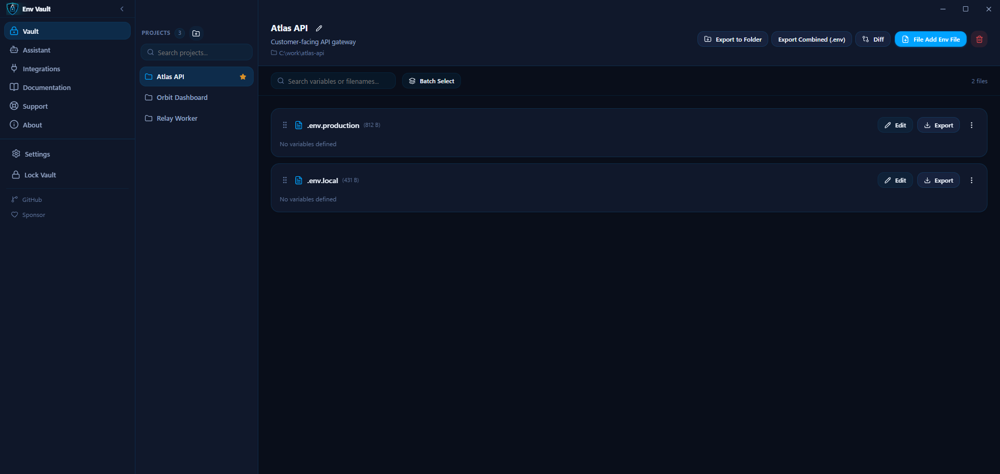 |
| Assistant | 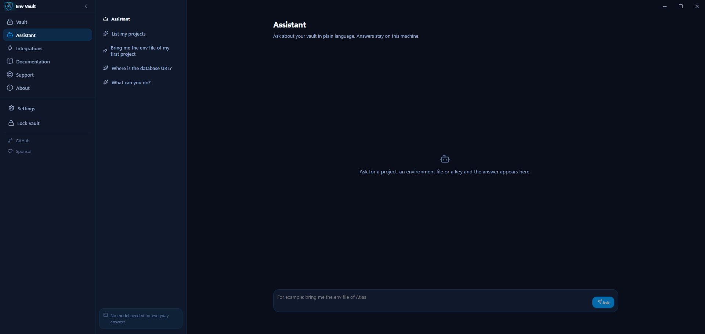 |
| Integrations - MCP | 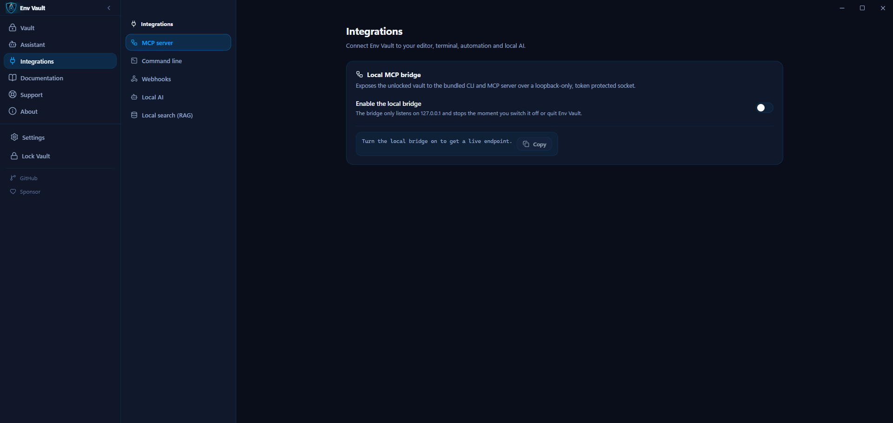 |
| Integrations - Local AI | 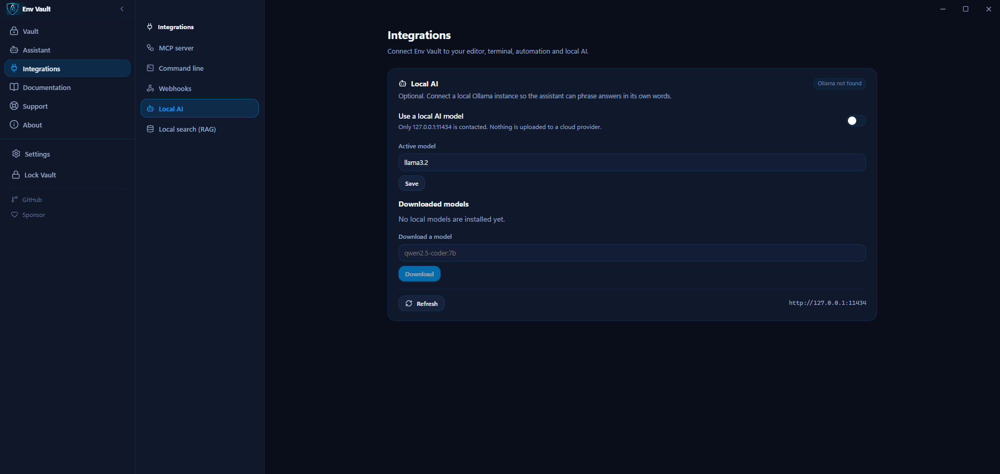 |
| General | 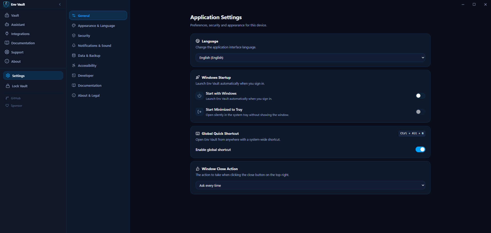 |
| Appearance &amp; Language | 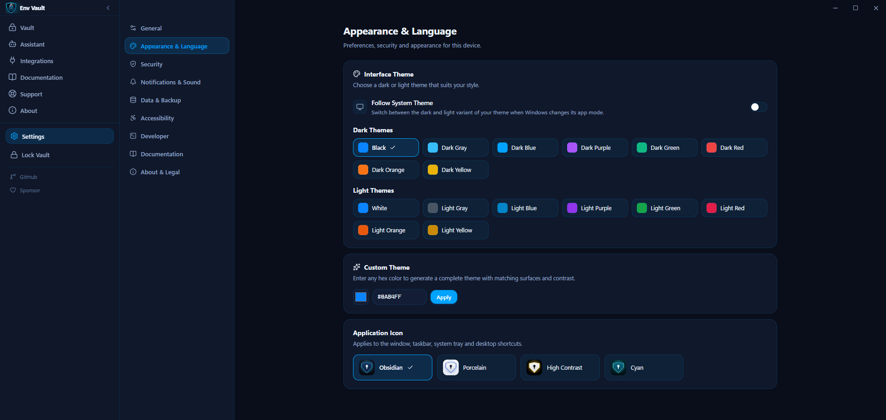 |
| Security | 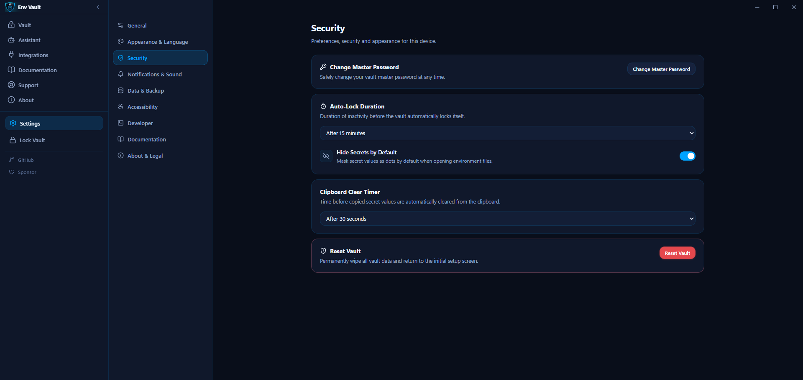 |
| Data &amp; Cloud Backup | 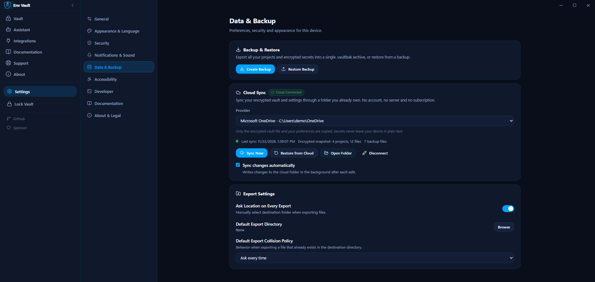 |
| Accessibility | 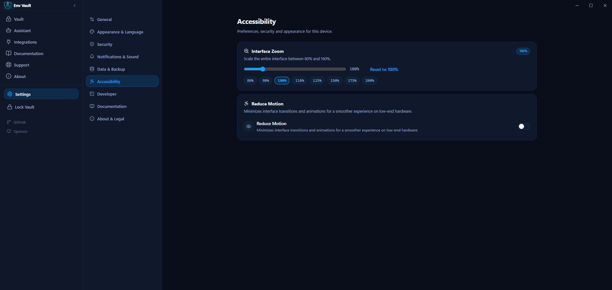 |
| Onboarding | 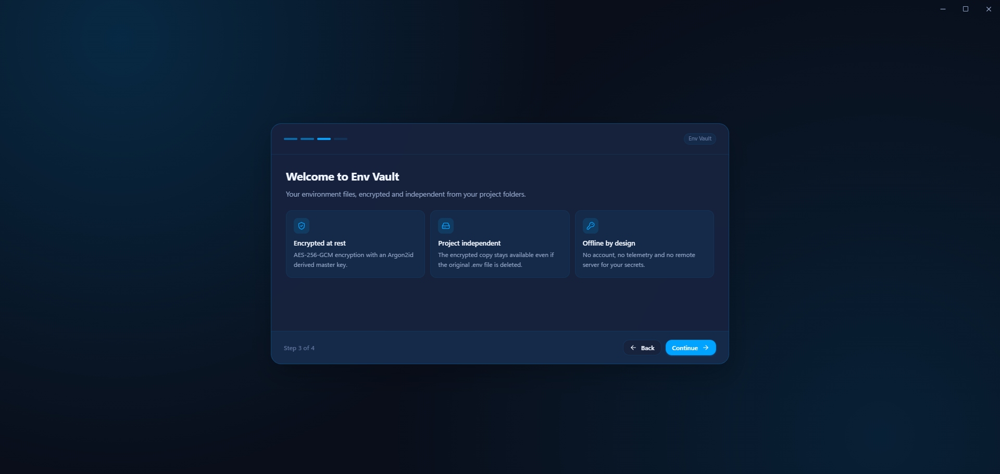 |
| Documentation | 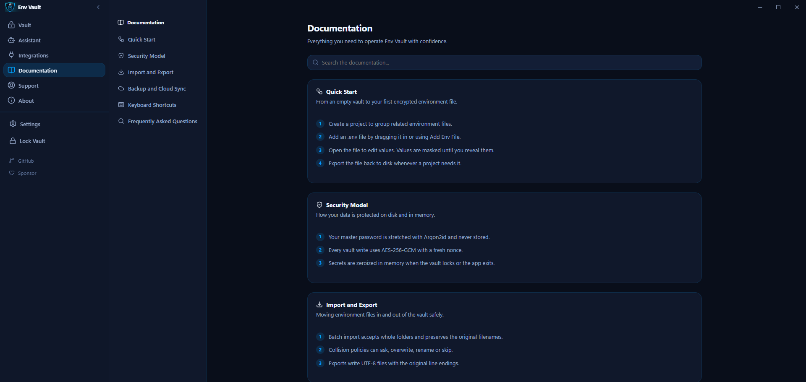 |
| About &amp; Legal | 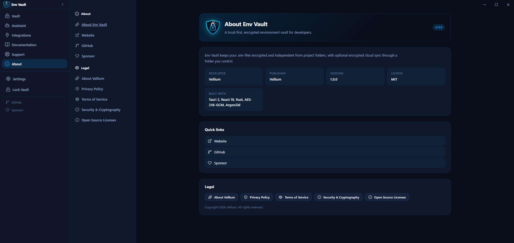 |

---

## Tech Stack

| Layer | Technology |
| --- | --- |
| Shell | Tauri 2 (`tauri` 2.x, NSIS and MSI bundling) |
| Core | Rust 2021, `serde`, `aes-gcm`, `argon2`, `windows` 0.58 |
| UI | React 19, TypeScript 5.7, Zustand 5 |
| Editor | CodeMirror 6 |
| Icons | Lucide React plus bundled brand SVGs |
| Build | Vite 6, `tsc`, `@tauri-apps/cli` |
| Tests | Vitest 3, Testing Library, `cargo test` |

---

## Project Structure

```text
Env_Vault/
  src/                     React application
    app/                   Root composition, view switching, effects
    components/            Layout, primitives, brand marks
    features/              vault, projects, settings, docs, support, about, onboarding, cloud
    i18n/                  Language catalog, dictionaries, loader
    lib/                   Theme engine, settings sync, Tauri API wrappers
    stores/                Zustand stores
    styles/                Tokens, themes, application styles
  src-tauri/               Rust core
    src/cloud/             Cloud snapshot service and provider detection
    src/platform/          Startup, icons, jump list, safe path opening
    src/settings/          Settings model and persistence
    src/vault/             Repository, cryptography and session
    src/commands/          Tauri command surface
  scripts/                 Locale generation, i18n parity and typography gates
  docs/                    Report, audit and screenshots
```

---

## Getting Started

### Requirements
- Windows 10 or Windows 11 (x64)
- Node.js 20 or newer
- Rust stable with the MSVC toolchain
- WebView2 runtime (included in current Windows builds)

### Development

```bash
npm install
npm run dev            # Vite dev server
npm run tauri dev      # Full desktop application
```

### Quality Gates

```bash
npm run typecheck      # TypeScript
npm test               # Vitest suites
npm run check:i18n     # 73-locale parity
npm run check:typography
npm run check:version
cd src-tauri && cargo test
```

### Build

```bash
npm run build:app      # Frontend build plus NSIS and MSI installers
npm run build:portable # Executable without an installer
```

Artifacts are written to `src-tauri/target/release/bundle/`.

---

## Security Model

- The vault is a single encrypted store; individual documents are sealed with AES-256-GCM.
- Argon2id parameters and the salt are stored in the vault header, never the password.
- No network listener, no analytics endpoint, no crash upload service.
- Diagnostics copy a redacted system summary and exclude secret values, passwords and document bodies.
- Imports and exports only touch paths confirmed through a native file dialog or a validated folder handle.

---

## Cloud Sync Format

```json
{
  "format": "env-vault-cloud",
  "version": 1,
  "exportedAt": "2026-01-01T12:00:00Z",
  "summary": { "projects": 4, "documents": 11 },
  "vault": "<base64 encrypted vault payload>",
  "preferences": { "language": "en", "theme": "koyu-mavi" }
}
```

The payload is the same encrypted vault blob used locally. Preferences contain no secrets, only interface choices.

---

## Contributing

1. Branch from `development`.
2. Keep `npm run typecheck`, `npm test`, `npm run check:i18n` and `npm run check:typography` green.
3. Do not use long dashes or emoji in source, docs or commit messages.
4. Open a pull request against `development`. Merging into `main` requires an explicit release decision.

---

## Support the Project

- [GitHub Sponsors](https://github.com/sponsors/emirtdede)
- [Issue tracker](https://github.com/emirtdede/env-vault/issues)
- [Vellium](https://vellium.dev)

---

## License

MIT. See [LICENSE](LICENSE).

---

<a id="turkish-version"></a>
# Türkçe Sürüm

<div align="center">
  <h3>Env Vault - Sırlarınızı proje klasörlerinin dışında tutun</h3>
  <p><em>Şifreli kasa, 73 dil, 4 sistem geneli ikon paketi, sunucusuz bulut senkronizasyonu ve yerel Windows entegrasyonu</em></p>
  <p><strong><a href="https://vellium.dev">Vellium</a> tarafından geliştirildi ve yayınlandı</strong></p>
</div>

<br>

## Proje Genel Bakış

**Env Vault (`v1.0.0`)**, `.env` dosyalarını proje klasörlerinden bağımsız olarak saklamak, düzenlemek ve dışa aktarmak için geliştirilmiş, yerel öncelikli bir Windows masaüstü uygulamasıdır. Çekirdek **Tauri 2 (Rust)**, arayüz **React 19 ve TypeScript** ile yazılmıştır.

Proje klasörleri sır saklamak için doğru yer değildir. Bir `.env` dosyası yanlışlıkla commit edilebilir, dal temizliğinde silinebilir veya klasör yeniden oluşturulduğunda kaybolabilir. Env Vault dosyayı şifreli kasaya alır ve kaynaktan tamamen bağımsız bir kopya tutar. Depo silinse bile kopya korunur.

Temel özellikler tamamen çevrimdışı çalışır: hesap yok, telemetri yok, harici API yok. Bulut senkronizasyonu isteğe bağlıdır ve kullanıcının zaten sahip olduğu bir klasöre şifreli arşiv yazar.

## Önemli Özellikler

- **Kopyala ve sakla mimarisi**: `.env` dosyaları sürükle-bırak, dosya seçici veya yapıştırma ile içe aktarılır; kasa kopyası kaynak dosyadan bağımsızdır.
- **Argon2id ve AES-256-GCM**: anahtar türetme ve kimlik doğrulamalı şifreleme; anahtar yalnızca bellekte tutulur, kilitlenince silinir.
- **73 dil**: ilk açılışta Windows görüntü dili kullanılır, İngilizce yedek dildir; Arapça, İbranice, Farsça ve Urduca için tam RTL desteği.
- **16 hazır tema ve özel tema**: herhangi bir hex rengi girilerek tam vurgu paleti üretilir; `Sistem`, `Açık` ve `Koyu` modları desteklenir.
- **4 ikon paketi**: `Obsidian`, `Porcelain`, `Contrast` ve `Cyan`; seçim pencere, görev çubuğu, sistem tepsisi ve kısayollara uygulanır.
- **Windows entegrasyonu**: Windows ile başlatma (sessiz tepsi başlangıcı), `Ctrl+Alt+N` genel kısayolu, görev çubuğu atlama listesi, tepsi menüsü.
- **Sunucusuz bulut yedeği**: OneDrive, Google Drive, Dropbox, iCloud Drive, Yandex Disk, Nextcloud veya özel klasör; atomik yazma, 15 günlük yedek rotasyonu, bozuk dosya kurtarma ve boş kasa koruması.
- **Ayarlar ve dokümantasyon**: Genel, Görünüm ve Dil, Güvenlik, Bildirimler, Veri ve Yedekleme, Erişilebilirlik, Dokümantasyon, Hakkında ve Yasal sekmeleri.
- **Kurulum dili seçimi**: NSIS kurulumu dosyaları kopyalamadan önce dil sorar ve Windows arayüz dilini varsayılan olarak seçer.

## Kurulum

1. `Env Vault_1.0.0_x64-setup.exe` dosyasını indirin.
2. Kurulum dilini seçin.
3. Kurulumdan sonra ana şifreyi belirleyin. Bu şifre geri alınamaz; güvenli bir yerde saklayın.

## Geliştirme

```bash
npm install
npm run tauri dev
npm run typecheck
npm test
npm run check:i18n
npm run check:typography
```

## Lisans

MIT. Ayrıntılar için [LICENSE](LICENSE) dosyasına bakın.
