# Env Vault - Project Report

**Version:** 1.0.0
**Publisher:** Vellium
**Platform:** Windows 10 / 11 (x64)
**License:** MIT
**Repository:** https://github.com/emirtdede/env-vault
**Report date:** 22 November 2026

---

## 1. Executive Summary

Env Vault is a Windows desktop application that keeps `.env` files out of project
folders and inside a local, encrypted vault. Developers import environment files
once, edit and organize them, and export them back to disk whenever a project
needs them. Because the encrypted copy lives independently of the source folder,
deleting a repository or an accidental `.env` cleanup no longer destroys the only
copy of a production secret.

Version 1.0.0 is the first corporate-grade release. It adds a complete desktop
shell (dual navigation rails, full-page settings, documentation, support and
about), a 73-language interface with right-to-left support, four application icon
packs, a serverless zero-cost cloud sync layer, Windows integration (tray, global
hotkey, jump list, start with Windows), and a reproducible NSIS installer with a
language selector.

The product ships with no telemetry, no analytics, no remote account, and no
network dependency for its core features.

---

## 2. Product Scope

### 2.1 Core Vault

| Capability | Description |
| --- | --- |
| Encrypted storage | AES-256-GCM authenticated encryption, Argon2id key derivation |
| Master password | Single master password, change and reset flows, no recovery backdoor |
| Projects | Group environment files per project, rename, describe, favorite, delete |
| Environment files | Create, read, update, rename, single and batch delete |
| Editor | Syntax highlighting, dirty state tracking, reveal toggle, save shortcut |
| Import | Drag and drop, file picker, folder scan, pasted multi-file blocks |
| Export | Single file, selection, project, merged project, entire vault |
| Diff | Compare keys and values between two environment files in a project |
| Backup | Encrypted `.vaultbak` export and restore with merge or replace strategy |
| Auto lock | Configurable idle lock with memory scrubbing on lock |

### 2.2 Desktop Shell

- Custom title bar with drag region, window controls and quick theme picker.
- Collapsible primary navigation rail: vault, settings, documentation, support, about.
- Secondary project sidebar with search, favorites and context actions.
- Full-page settings shell with its own section navigation.
- Toast host, confirmation dialogs, close action dialog and restore prompt banner.
- Keyboard shortcuts: `Ctrl+N`, `Ctrl+O`, `Ctrl+L`, `Ctrl+S`, `Ctrl+F`, `Ctrl+,`.
- Global shortcut `Ctrl+Alt+N` to show and focus the window.

### 2.3 Appearance and Accessibility

- 14 built-in palettes, split into dark and light families.
- Empty custom palette entry that accepts any hex color and derives a full,
  contrast-aware token set at runtime.
- Follow Windows app mode (System / Light / Dark behavior through theme pairing).
- Four icon packs: Obsidian, Porcelain, Contrast, Cyan.
- Interface zoom from 80 percent to 200 percent.
- Reduced motion switch driven by a document-level attribute.
- Right-to-left layout for Arabic, Hebrew, Farsi and Urdu.

### 2.4 Windows Integration

- System tray icon with Show, Settings, Lock Vault, Sync Now and Quit actions.
- Minimize to tray on close, ask every time, or exit, selectable and memorable.
- Optional start with Windows through the per-user Run registry key.
- Silent tray start (`--minimized`) for autostart sessions.
- Taskbar jump list with Settings, New Project and Lock Vault tasks.
- One-click support information copy for bug reports.

### 2.5 Cloud Sync (Serverless, Zero Cost)

Env Vault does not run a backend. Sync writes an encrypted snapshot into a folder
that a consumer cloud client already synchronizes:

- Provider auto-detection for OneDrive, Google Drive, Dropbox and any custom folder.
- Folder name `EnvVault`, files `env-vault-cloud-sync.json`,
  `env-vault-cloud-sync-previous.json` and
  `env-vault-cloud-sync-backup-YYYY-MM-DD.json`.
- 15-day backup rotation.
- Atomic write with rename, plus `EBUSY` / `EPERM` fallback.
- Recovery chain: current, previous, then dated backups.
- Empty-local guard prevents overwriting the cloud with an empty vault.
- 300 ms debounce on content changes and a flush on application exit.
- Restore proposal banner on startup when the cloud has newer data.
- Localized toasts for connect, sync, restore and failure states.

The snapshot contains the encrypted vault blob and a preference snapshot. No
plaintext secret, master password or derived key is ever written to the cloud.

---

## 3. Architecture

### 3.1 Technology Stack

| Layer | Technology |
| --- | --- |
| Desktop runtime | Tauri 2 (Rust) |
| User interface | React 19, TypeScript 5, Vite 6 |
| State | Zustand stores |
| Icons | lucide-react plus raster icon packs |
| Editor | CodeMirror language support |
| Crypto | `aes-gcm`, `argon2`, `zeroize` |
| Native shell | `windows` crate (COM, registry, shell execute) |
| Packaging | NSIS and MSI through Tauri bundler |

### 3.2 Repository Layout

```text
src/
  app/                 Application shell and effects
  components/          Layout, brand and primitives
  features/            Vault, projects, env documents, editor, import,
                       backup, onboarding, settings, docs, support, about, cloud
  hooks/               Shared UI flows
  i18n/                Dictionaries, locale catalog, lazy loader
  lib/                 Theme engine, settings sync, cloud autosync, Tauri APIs
  stores/              Zustand domain and preference stores
  styles/              Tokens, themes, shell and component styles
src-tauri/
  src/backup/          Portable backup format and service
  src/cloud/           Cloud detection, snapshot, rotation and recovery
  src/commands/        Tauri command surface
  src/crypto/          KDF, cipher, random and zeroization
  src/env/             Encoding detection and dotenv parser
  src/export/          Export strategies
  src/import/          Import strategies
  src/platform/        Windows startup, icons, jump list, DPAPI, drag and drop
  src/settings/        Settings model and service
  src/vault/           Encrypted repository, session and service
scripts/               Quality gates, locale generation, icon generation
.github/workflows/     Continuous integration
docs/                  Screenshots and audit reports
```

### 3.3 Frontend Composition

`App.tsx` owns initialization and cross-cutting effects:

1. Load settings from the native settings service.
2. Update the preference store and initialize the i18n dictionary.
3. Fetch vault state.
4. Resolve and apply theme, accent, zoom, reduced motion and text direction.
5. Subscribe to native events (navigate, lock, close request).
6. Register keyboard shortcuts.
7. Start the debounced cloud auto-sync while the vault is unlocked.

Views are gated by vault state:

- `uninitialized`: vault creation screen, with onboarding overlay.
- `locked`: unlock screen.
- `error`: recoverable error state with refresh.
- `unlocked`: navigation rail plus the selected view.

### 3.4 Native Composition

`lib.rs` builds the Tauri application and wires:

- Global shortcut plugin with a show and focus handler.
- Single instance plugin that routes launch arguments into the running shell.
- Tray icon, menu and click behavior.
- Startup registry and icon pack application.
- Jump list generation through COM.
- Close policy enforcement (`minimize-to-tray`, `ask`, `close-app`).
- Cloud flush on exit.
- The complete command registry.

### 3.5 Security Model

- Master password is processed with Argon2id (64 MB memory, 3 iterations, 4 lanes).
- Vault payloads are encrypted with AES-256-GCM and a unique nonce per write.
- Keys and plaintext buffers are zeroized on drop and on lock.
- The session key is stored in memory only. DPAPI protects local configuration
  and session artifacts on disk.
- Lock clears editor content and document lists from the frontend stores.
- External URLs are restricted to `http` and `https`, then opened through the
  Windows shell.
- Path opening is validated before use.
- No secret, password or token is logged or sent over the network.

---

## 4. Localization

- 73 locales in `src/i18n/languages.json`, each with native and English names.
- English and Turkish dictionaries are hand maintained and serve as the source
  of truth (`src/i18n/locales/en.ts`, `tr.ts`).
- The remaining 71 dictionaries are generated from the English source once and
  committed as JSON, then loaded lazily by the runtime.
- English is the fallback for any missing key.
- `RTL_LANGUAGES` drives `dir="rtl"` for Arabic, Hebrew, Farsi and Urdu.
- The Windows UI language selects the initial locale; unsupported languages fall
  back to English.
- The installer exposes an NSIS language selector with more than 50 languages.

Parity is enforced by `scripts/check-i18n-keys.mjs`: 573 keys across 73 locales.

---

## 5. Quality Gates

| Gate | Command | Result |
| --- | --- | --- |
| TypeScript | `npm run typecheck` | Pass |
| Unit tests | `npm test` | 19 tests, 6 files |
| Rust tests | `cargo test` | 29 unit tests, 4 integration tests |
| Production build | `npm run build` | Pass |
| i18n parity | `npm run check:i18n` | 573 keys, 73 locales |
| Typography | `npm run check:typography` | No long dashes, no emoji |
| Version consistency | `node scripts/check-version-consistency.js` | 1.0.0 everywhere |
| Installer | `npx tauri build --bundles nsis` | `Env Vault_1.0.0_x64-setup.exe` |

Continuous integration runs the frontend gates on Ubuntu and the Rust tests on
`windows-latest`.

---

## 6. Screenshots

### Settings - General

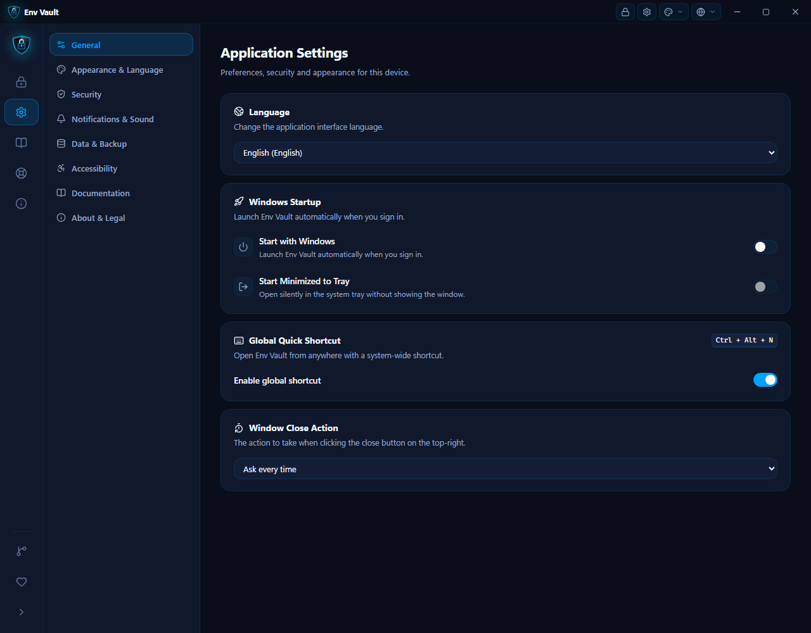

### Settings - Appearance

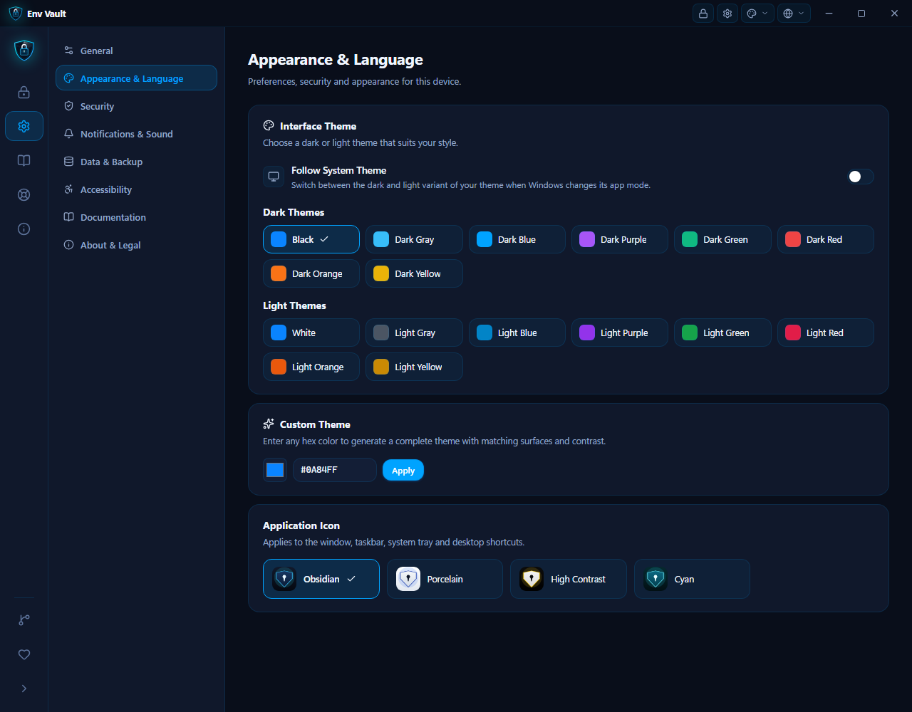

### Settings - Security

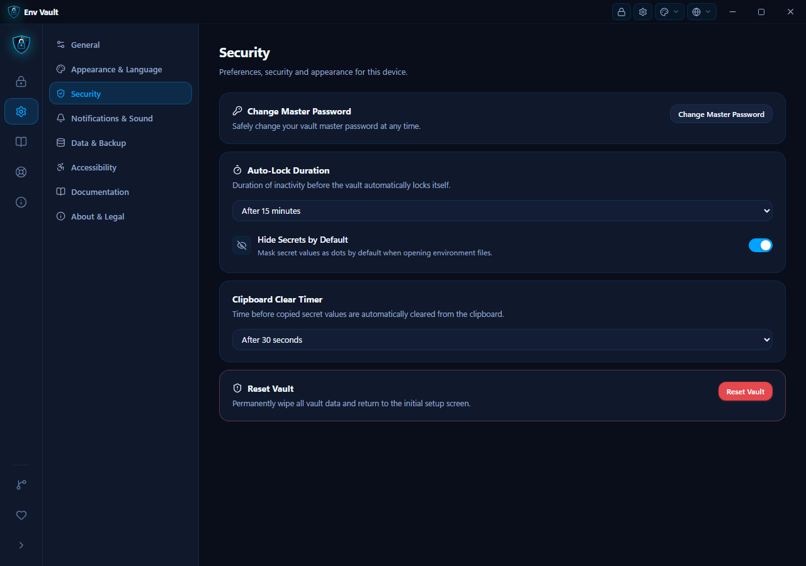

### Settings - Notifications

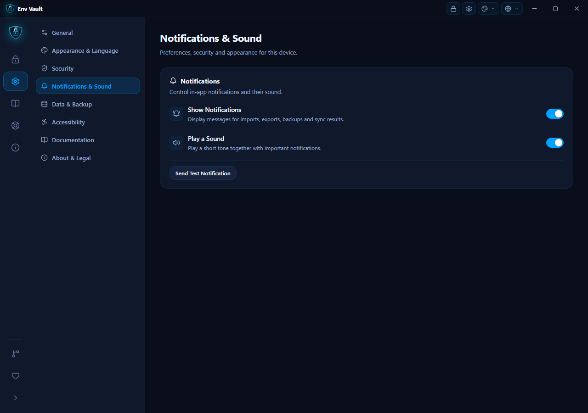

### Settings - Data and Cloud Sync

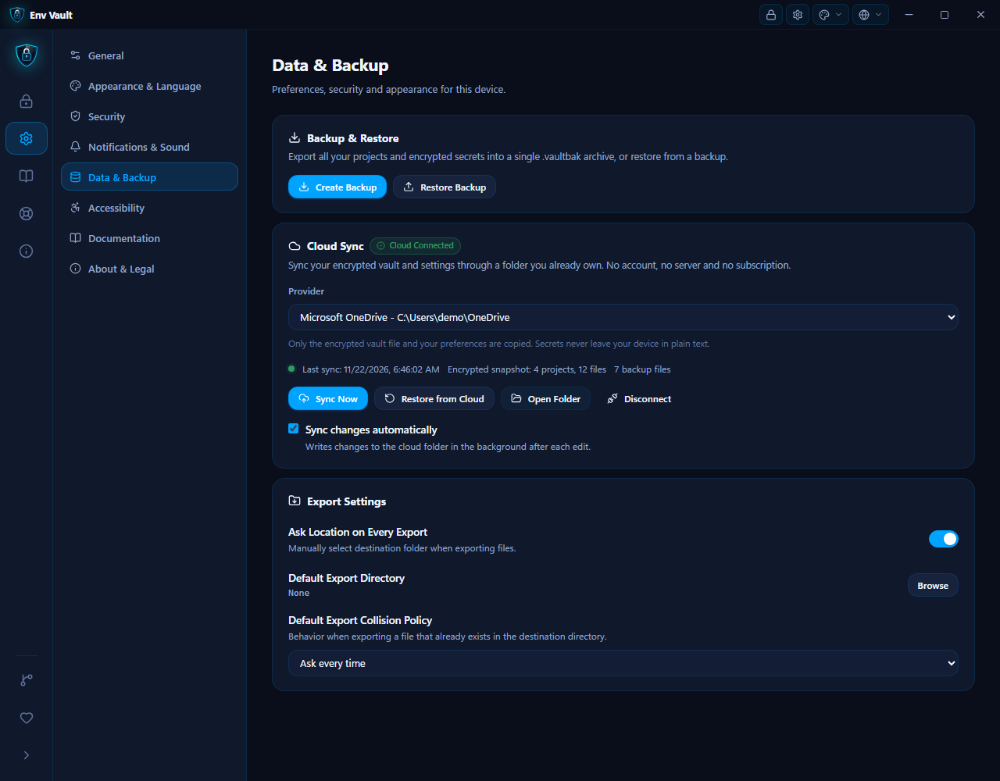

### Settings - Accessibility

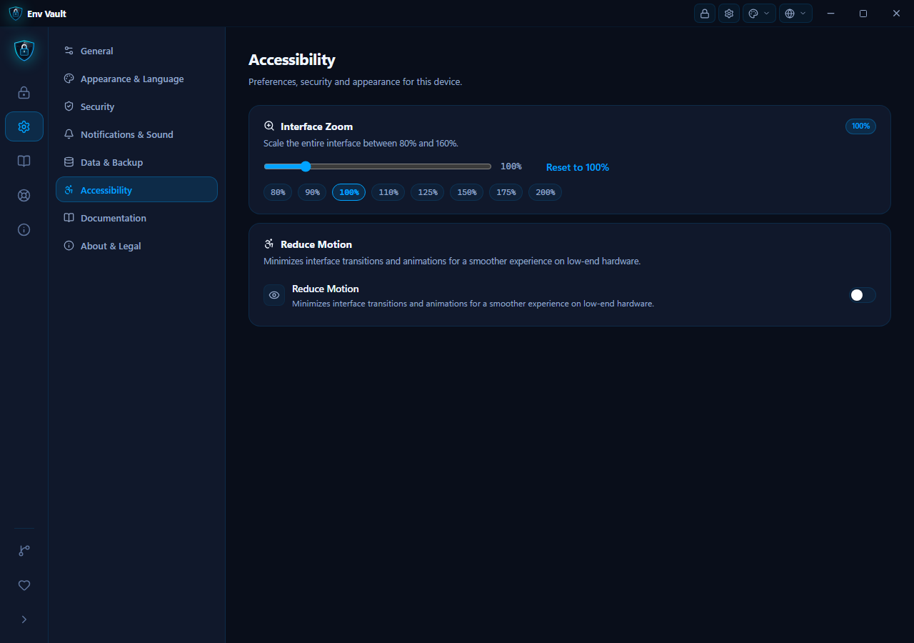

### Documentation

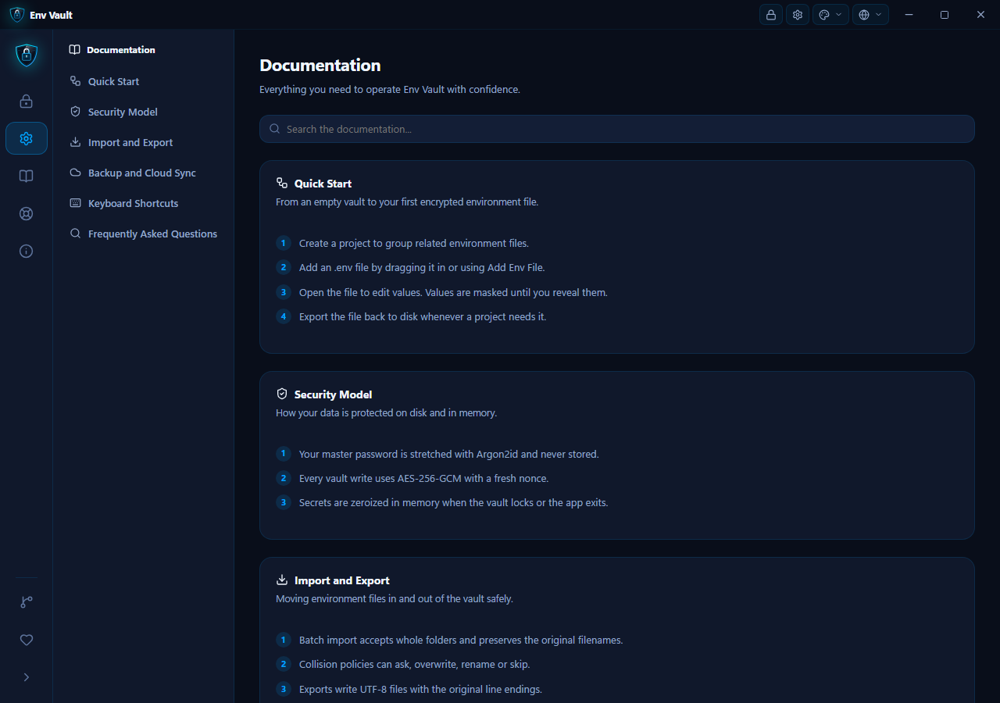

### Support and Diagnostics

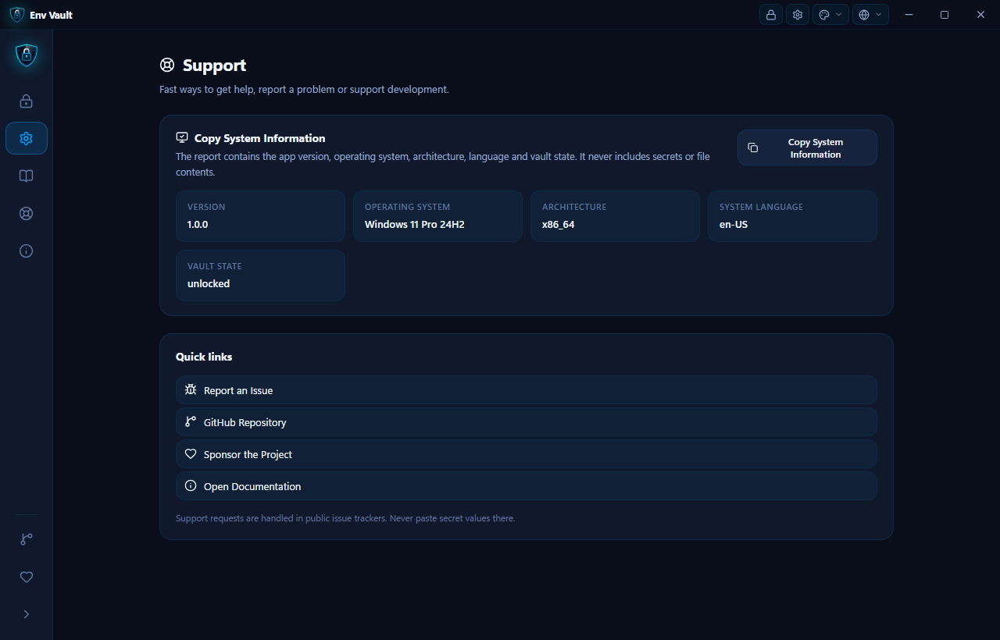

### About

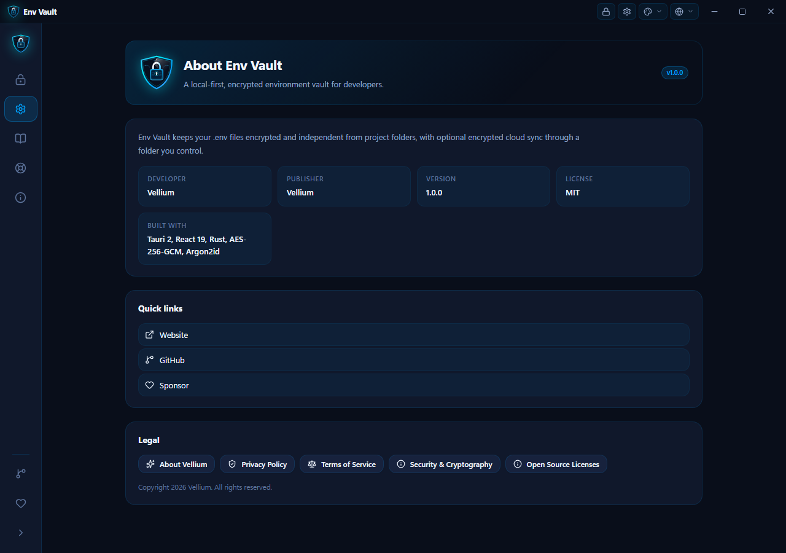

### Onboarding

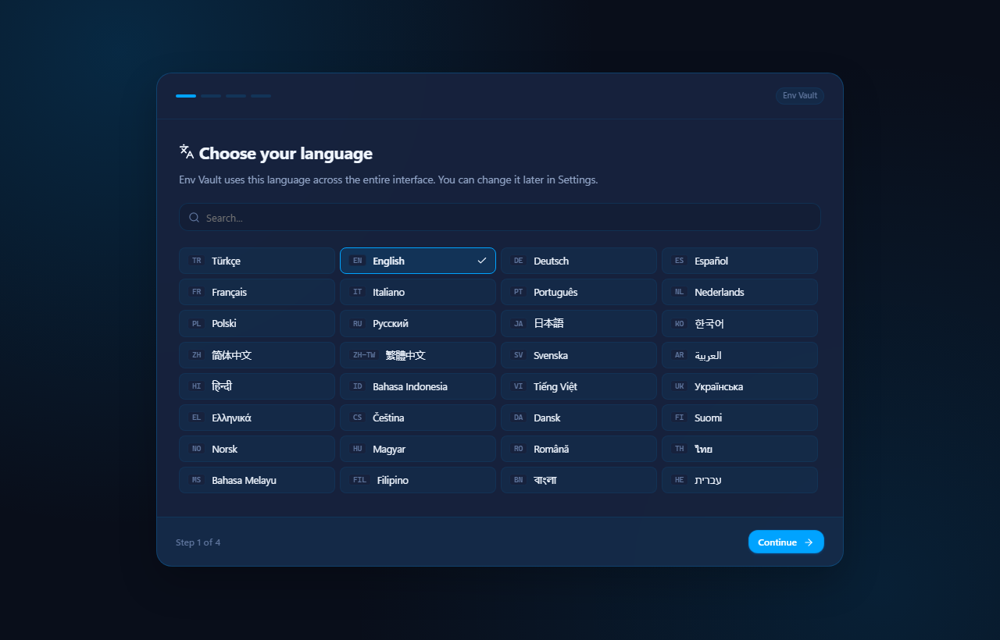

### Vault Setup

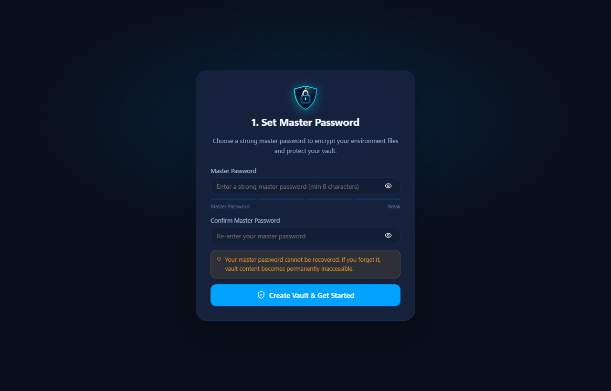

---

## 7. Packaging and Distribution

- Product name: `Env Vault`
- Identifier: `com.vellium.envvault`
- Publisher: Vellium
- Installer: NSIS, per-user install mode, language selector enabled
- Additional target: MSI (`en-US`)
- Bundle icons: 13 sizes, including NSIS header and sidebar bitmaps
- Installer output: `src-tauri/target/release/bundle/nsis/Env Vault_1.0.0_x64-setup.exe`
- Installer size: approximately 4.0 MiB
- A winget manifest can be generated from the release artifact and publisher metadata.

---

## 8. Known Boundaries

- Env Vault targets Windows only in 1.0.0. The codebase keeps platform-specific
  behavior behind `cfg` blocks, but other platforms are not validated.
- The generated dictionaries are machine translated and committed once. They are
  functional and consistent, but not professionally reviewed per locale.
- Cloud sync relies on the provider client to move files. Env Vault does not
  implement its own transport, account system or conflict resolution beyond the
  current, previous and dated backup chain.

---

## 9. Result

Env Vault 1.0.0 is feature complete for its stated scope, fully localized, free of
long dashes and emoji in the interface and source, covered by automated quality
gates, and packaged as a signed-ready Windows installer. All quality gates are
green and the pre-deployment audit reports zero open findings.
